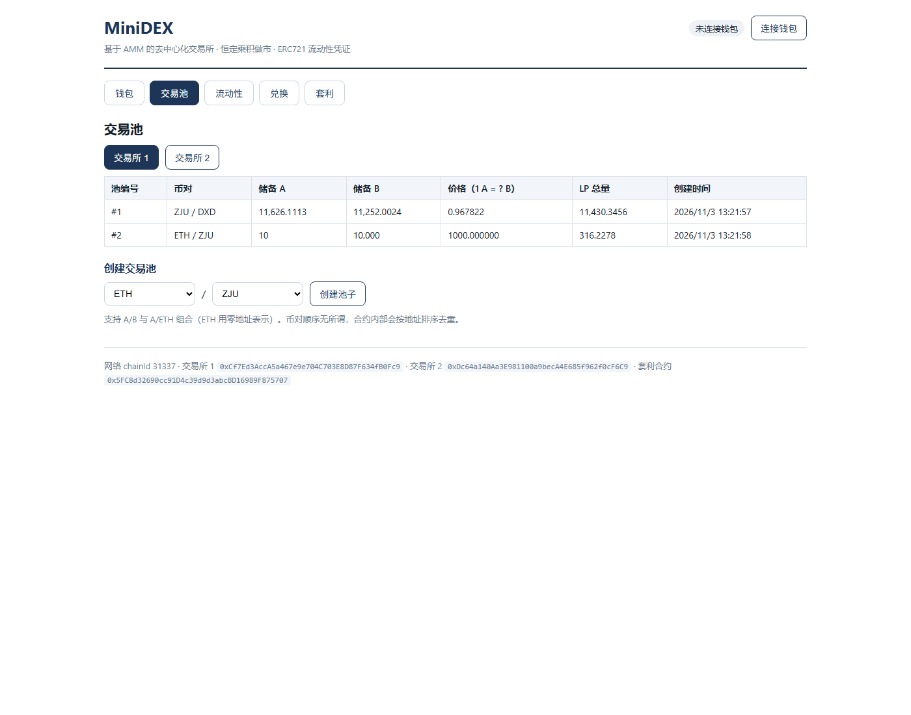
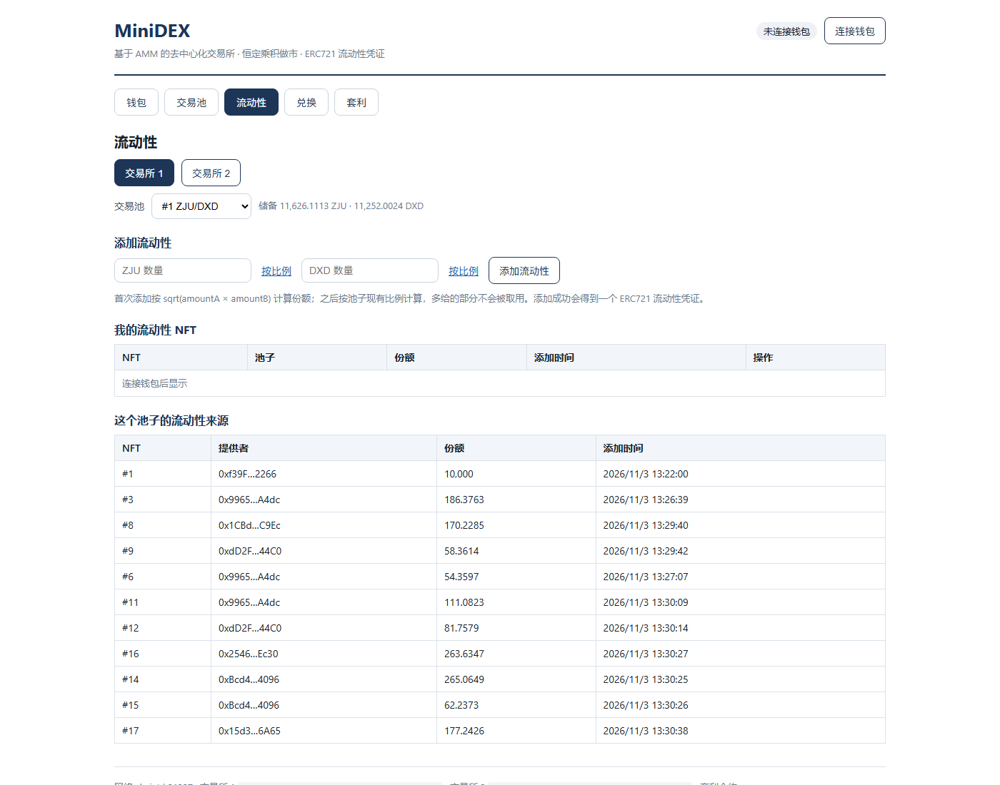
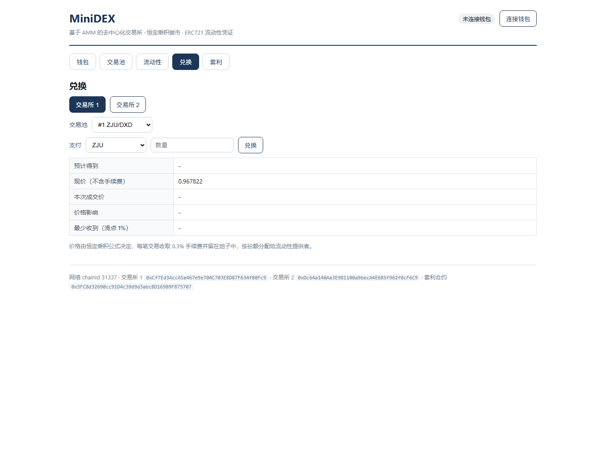
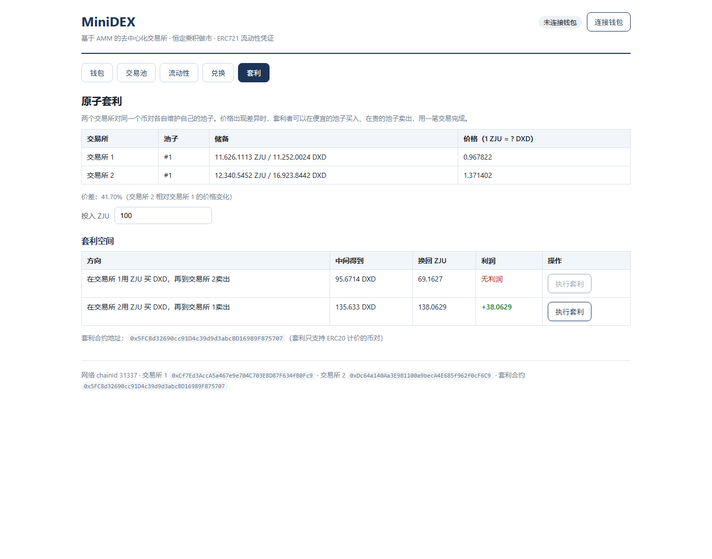
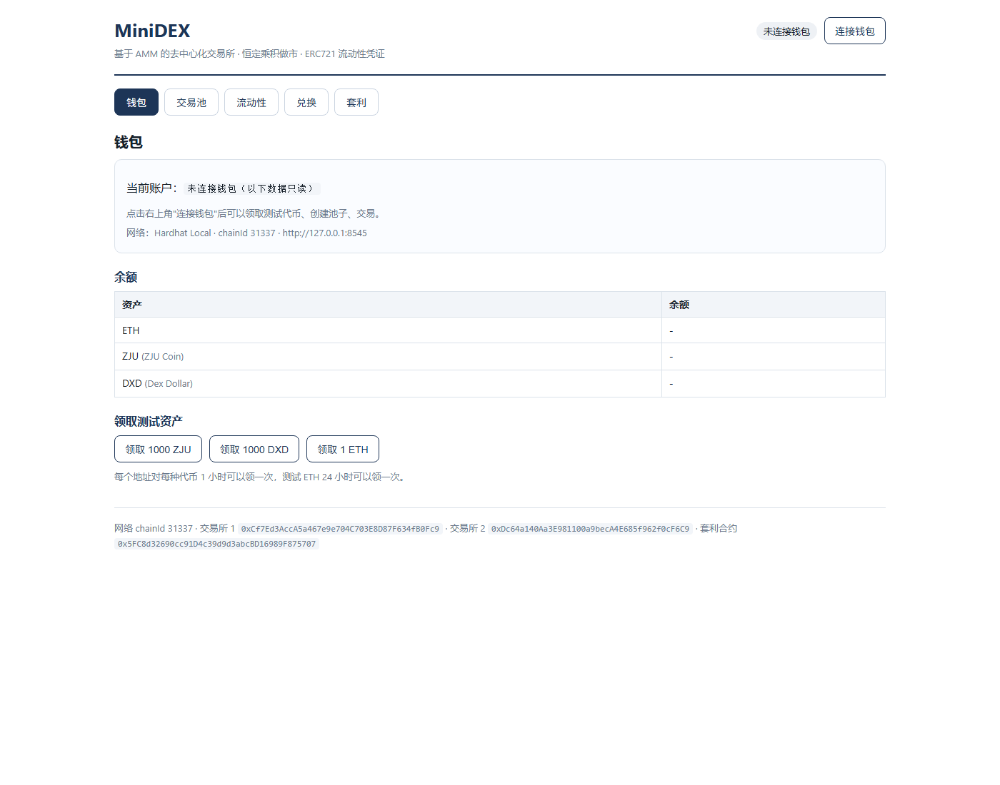

# MiniDEX —— 基于 AMM 的去中心化交易所

区块链与数字货币 第二次作业

- 姓名：孙元浩
- 学号：3230102822
- 学院：计算机科学与技术学院 2023 级

项目包含三个参与方：交易用户（User）、流动性提供者（LP）、套利者（Arbitrageur）。

---

## 一、功能概览

| 作业要求 | 实现情况 |
| --- | --- |
| 至少两个 ERC20 代币，可领取测试代币与测试以太币 | `MockERC20`（ZJU、DXD 两种，`faucet()` 每个地址 1 小时可领 1000 枚）+ `ETHFaucet`（每个地址 24 小时可领 1 ETH），前端"钱包"页一键领取 |
| 前端创建交易池，支持 A/B 与 A/ETH | `MiniDEX.createPool(tokenA, tokenB)`，原生 ETH 用 `address(0)` 表示，前端可任选币对建池 |
| 维护储备量、恒定乘积定价、考虑手续费 | 池子存 `reserveA / reserveB`，`getAmountOut` 用 `x*y=k` 并扣 0.3% 手续费；每次 `swap` 后同步更新储备 |
| 提供交易、添加/撤销流动性接口 | `swap` / `addLiquidity` / `removeLiquidity` |
| 手续费按比例分配给 LP | 0.3% 手续费直接沉淀在储备中，LP 按份额分享（撤池时自动包含） |
| LP 凭证是 ERC721，含池信息、数量、时间 | `MiniDEX` 继承 OpenZeppelin `ERC721Enumerable`，每次加流动性 mint 一个 NFT，`positions(nftId)` 记录池号/份额/时间，`tokenURI` 链上生成 metadata |
| 前端查看每个池子的流动性来源和自己的 NFT | "流动性"页下半部分列出池内全部 NFT 及其提供者、份额、时间；上半部分列出自己持有的 NFT |
| 销毁 NFT 取回代币与手续费分红 | `removeLiquidity(nftId)` 校验持有者 → 按份额退回两种代币 → `_burn` |
| 至少 20 个模拟用户随机交易、加减流动性 | `contracts/scripts/simulate.ts` 用 Hardhat 本地的 20 个账户随机执行 60 步操作，并让套利者周期性出手 |
| Bonus 1：部署多个交易所，同币对不同价格 | 部署了两个 `MiniDEX` 实例（交易所 1 / 2），初始化储备比例不同（1 : 1 与 1 : 1.5），前端可切换查看 |
| Bonus 2：原子套利合约，一次交易完成，失败 revert，展示前后价格与利润 | `Arbitrage.arbitrage()` 在一笔交易内完成"低价买入 + 高价卖出"，末尾校验利润，不满足整体 revert；事件里带套利前后两个池子的价格，前端"套利"页展示方向、预期利润与执行结果 |

## 二、技术栈

- 合约：Solidity 0.8.20 + Hardhat 3 + ethers v6 + TypeScript，依赖 OpenZeppelin 5.4.0（ERC20 / ERC721 / ERC721Enumerable / SafeERC20 / ReentrancyGuard）
- 前端：React 19 + Vite 8 + ethers v6，直接连接 MetaMask（`window.ethereum`）
- 链：本地 Hardhat 节点（chainId 31337，内置 20 个测试账户）

目录结构：

```
contracts/
├── contracts/
│   ├── MiniDEX.sol       AMM 交易所（池子、兑换、流动性 ERC721）
│   ├── MockERC20.sol     测试代币（带 faucet）
│   ├── ETHFaucet.sol     测试以太币水龙头
│   └── Arbitrage.sol     原子套利合约
├── scripts/
│   ├── deploy.ts         部署全部合约，地址与 ABI 自动写入前端
│   ├── seed.ts           创建演示池子并注入初始流动性
│   └── simulate.ts       20 个模拟用户的随机交易脚本
└── test/MiniDEX.test.ts  14 个单元测试
frontend/
└── src/
    ├── utils/web3.ts     合约实例、读链、钱包连接、格式化
    └── pages/            钱包 / 交易池 / 流动性 / 兑换 / 套利 五个页面
```

## 三、如何运行

### 1. 启动本地链

```bash
cd contracts
npm install            # 首次运行需要
npm run node           # 启动 Hardhat 节点，监听 127.0.0.1:8545，保持这个终端不要关
```

节点启动后会打印 20 个账户及其私钥，MetaMask 里需要用到。

### 2. 编译与测试（可选）

```bash
cd contracts
npm run compile        # hardhat build，输出编译成功
npm test               # 14 个单元测试
```

### 3. 部署合约

另开一个终端：

```bash
cd contracts
npm run deploy
```

脚本会依次部署 `MockERC20 ×2`、`ETHFaucet`、`MiniDEX ×2`、`Arbitrage`，并把地址写入 `frontend/src/utils/deployments.json`、ABI 写入 `frontend/src/utils/abis/`。终端里会打印全部地址。

### 4. 准备演示数据（可选）

```bash
npm run seed           # 创建 ZJU/DXD、ETH/ZJU 池子并注入初始流动性，给 11 个账户发币
```

### 5. 启动前端

```bash
cd frontend
npm install            # 首次运行需要
npm run start          # Vite 开发服务器，http://localhost:3000
```

### 6. 配置 MetaMask

在 MetaMask 中添加网络：

| 项 | 值 |
| --- | --- |
| RPC URL | `http://127.0.0.1:8545` |
| Chain ID | `31337` |
| 货币符号 | ETH |

然后导入测试账户私钥（`npm run node` 打印的任意一个），即可领取测试代币、创建池子、添加流动性、兑换、套利。

多账户演示：再导入 2～3 个私钥，分别扮演 LP、交易用户和套利者。

### 7. 模拟 20 个用户（要求 4）

```bash
cd contracts
npm run simulate
```

脚本会打印每一步操作与交易哈希，结束时汇总两个交易所的储备、价格与 NFT 数量。

## 四、功能实现分析

### 1. 交易池

`createPool(tokenA, tokenB)` 内部先按地址排序（所以 `A/B` 与 `B/A` 是同一个池子），再用 `_poolIdOf[tokenA][tokenB]` 去重。池子结构：

```solidity
struct Pool {
    address tokenA;
    address tokenB;
    uint256 reserveA;
    uint256 reserveB;
    uint256 totalLP;          // 份额总量
    uint256 createdTimestamp;
}
```

原生 ETH 用 `address(0)` 表示，因此 `A/B`、`A/ETH` 两种池子走同一套逻辑，不需要额外引入 WETH。

### 2. 恒定乘积定价与手续费

```solidity
function getAmountOut(uint256 amountIn, uint256 reserveIn, uint256 reserveOut) public pure returns (uint256) {
    uint256 amountInWithFee = amountIn * 997;
    return amountInWithFee * reserveOut / (reserveIn * 1000 + amountInWithFee);
}
```

即 `out = 0.997·in·Rout / (Rin + 0.997·in)`，0.3% 手续费在公式里被扣掉，但**输入全额进入储备**，所以 `k = reserveA × reserveB` 每笔交易后都会略微变大 —— 这部分增量就是留给 LP 的手续费。

### 3. 流动性与 ERC721 凭证

- 首次添加：`liquidity = sqrt(amountA × amountB)`，并要求大于 `MIN_LIQUIDITY`，避免粉尘池；
- 后续添加：`liquidity = min(amountA·totalLP/reserveA, amountB·totalLP/reserveB)`，按现有比例折算，多给的部分不会被取用（只按比例转入）；
- 铸造 NFT：`_mint(msg.sender, nftId)`，同时写入 `positions[nftId] = {poolId, amount, timestamp}` 并 `_poolNftIds[poolId].push(nftId)`，后者让前端能列出"这个池子的流动性来源"；
- 元数据：`tokenURI` 用 `Base64` 在链上拼出 JSON（池号、两种代币、份额、添加时间），符合"NFT 包含流动性池信息、数量、时间信息"的要求。

### 4. 撤销流动性与手续费分红

`removeLiquidity(nftId)`：

```solidity
amountA = position.amount * pool.reserveA / pool.totalLP;
amountB = position.amount * pool.reserveB / pool.totalLP;
```

因为手续费留在储备里，储备比 LP 刚注入时更多，所以同样份额撤池时能拿回比本金更多的代币 —— 手续费分红不需要单独记账。单元测试里验证了这一点：100 / 100 的池子经过 5 次兑换后撤池，拿回的 ZJU 大于 100。

### 5. 兑换

`swap(poolId, tokenIn, amountIn, minAmountOut)`：确定方向上/下储备 → 拉取输入（ETH 用 `msg.value`，ERC20 用 `safeTransferFrom`）→ 计算输出 → `require(amountOut >= minAmountOut)` 滑点保护 → 更新储备 → 转出。函数带 `nonReentrant`，ETH 转出用 `call`。

### 6. 两个交易所与价格差（Bonus 1）

`deploy.ts` 部署两个独立的 `MiniDEX` 实例。`seed.ts` 给交易所 1 注入 10000 ZJU / 10000 DXD（价格 1.0），给交易所 2 注入 10000 ZJU / 15000 DXD（价格 1.5），天然形成 50% 价差。前端"套利"页可以同时看到两个池子的储备、价格与价差。

### 7. 原子套利（Bonus 2）

`Arbitrage.arbitrage(dexBuy, poolIdBuy, dexSell, poolIdSell, tokenIn, amountIn, minProfit)`：

1. 从用户处拉走 `amountIn`，授权给 `dexBuy`；
2. `dexBuy.swap(...)` 换出中间代币；
3. 把中间代币授权给 `dexSell` 并 `dexSell.swap(...)` 换回 `tokenIn`；
4. 用余额差判断利润：`require(endBalance >= startBalance + amountIn, "Arb: no profit")`，再校验 `minProfit`；
5. 任一步骤失败，整笔交易 revert —— 包括两次 swap 造成的储备变化，不会留下半套利状态；
6. 事件 `ArbitrageExecuted` 记录买入/卖出前后的价格、中间数量与利润，前端直接展示。

`checkOpportunity(...)` 是不发交易的只读版本，供前端在两种套利方向上比较利润。

### 8. 模拟用户（要求 4）

`simulate.ts` 取 Hardhat 节点的 20 个账户，随机执行 60 步操作：60% 兑换、25% 添加流动性、15% 撤销流动性；每 6 步让套利者检查一次两个交易所的价差，有利润就发起套利。实测一次运行结果：

```
共执行 53 笔交易，其中套利 9 笔
交易所 1 ZJU/DXD 池#1：储备 11626.11 ZJU / 11252.00 DXD，价格 0.967822，LP 总量 11430.35
交易所 2 ZJU/DXD 池#1：储备 12340.55 ZJU / 16923.84 DXD，价格 1.371402，LP 总量 14445.92
交易所 1 ETH/ZJU 池#2：储备 10.0000 ETH / 10000.00 ZJU
20 个用户当前持有流动性 NFT 共 26 个
```

单次套利利润约 25 ZJU，执行后两个池子的价格差被拉小（交易所 2 的价格从 1.5 降到 1.371）。

## 五、项目运行截图

交易池（可以看到两个池子的储备与实时价格）：



流动性（自己的 NFT 与池子的流动性来源）：



兑换（报价、现价、本次成交价与价格影响）：



原子套利（两个交易所的价格差与两个方向的预期利润）：



钱包（余额与测试资产领取）：



## 六、测试

```bash
cd contracts
npm test
```

14 个用例，覆盖：建池去重与排序、首次/后续加流动性份额计算、NFT 铸造与元数据、撤池含手续费分红、非持有人不能撤池、兑换输出与报价一致、`k` 值变大、滑点回滚、价格随交易变化、ETH 池双向兑换、水龙头冷却、套利盈利、无价差时整体回滚、`minProfit` 保护。

## 七、参考内容

- 课程参考 Demo：[blockchain-course-demos](https://github.com/LBruyne/blockchain-course-demos)
- 作业框架：[ZJU-blockchain-course-2026](https://github.com/LBruyne/ZJU-blockchain-course-2026)
- AMM 交易所原理（恒定乘积、LP 份额）：[Uniswap V2 白皮书](https://uniswap.org/whitepaper.pdf)、[WTF Academy Solidity 103 DEX](https://www.wtf.academy/en/docs/solidity-103/DEX/)
- ERC20 / ERC721 模板：[OpenZeppelin Contracts 5.4](https://docs.openzeppelin.com/contracts/5.x/)、[Contracts Wizard](https://wizard.openzeppelin.com/)
